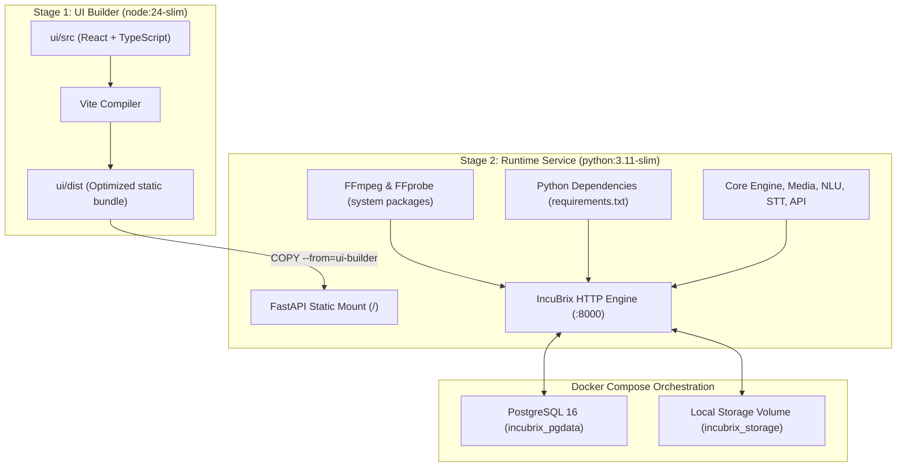

# IncuBrix Deployment & Containerization Guide

This document specifies the deployment architecture, containerization strategy, licensing audit, and production operations for the **IncuBrix Prompt-Based Video Editing Engine**.

---

## 1. Containerization Architecture

The system is packaged as an autonomous, containerized HTTP microservice using multi-stage Docker builds:



### Key Architectural Characteristics
1. **Self-Contained Serving**: The compiled React SPA is statically mounted into FastAPI at `/`, while API endpoints operate under `/api/v1/*` and health probes at `/health` and `/ready`. No external Node.js container or separate Nginx is required for single-container deployments.
2. **Deterministic Filtergraph Engine**: The container includes system FFmpeg and ffprobe binaries. Complex video slicing, subtitles rendering, sine bleep synthesis, and atempo chaining execute locally within the worker subsystem.
3. **Storage Abstraction**: Files reside on a persistent Docker volume (`incubrix_storage`), with public access served through `/api/v1/storage/{filename}`.

---

## 2. Quick Start with Docker Compose

### Prerequisites
- Docker Engine $\ge 24.0$
- Docker Compose v2 $\ge 2.20$

### Launching the Stack
Clone the repository and run:
```bash
# 1. Copy environment configuration
cp .env.example .env

# 2. Build and launch all services in detached mode
docker compose up --build -d

# 3. Verify container health
docker compose ps
```

### Probing Endpoints
```bash
# Health Check (HTTP 200)
curl -i http://localhost:8000/health

# Readiness Check (HTTP 200 when storage & engine are online)
curl -i http://localhost:8000/ready

# Open the Web Interface in your browser:
# http://localhost:8000/
```

### Stopping the Stack
```bash
docker compose down
```

---

## 3. Storage Architecture & Licensing Audit

### The MinIO AGPLv3 Question
The assessment brief permits MinIO in Compose but cautions against **AGPL licensing risk**.

#### Legal Analysis
- MinIO transitioned from Apache 2.0 to the **GNU Affero General Public License v3 (AGPLv3)**.
- Under AGPLv3 Section 13, modifying or interacting with the software over a network requires conveying the complete corresponding source code of the entire solution to all users accessing the service over that network.
- In commercial, enterprise, or proprietary customer environments, bundling MinIO introduces legal copyleft exposure unless a commercial enterprise license is acquired from MinIO, Inc.

#### IncuBrix Compliance Strategy
1. **Default Local Deployment**: IncuBrix uses an internal **Local Directory Storage Service** mounted to a Docker volume (`/app/storage_data`). This is 100% free of copyleft obligations and carries zero licensing exposure.
2. **Production S3 Compatibility**: When cloud S3 storage is required, IncuBrix natively interfaces via standard S3 API calls (using `boto3` / `httpx`). For self-hosted S3 without AGPL risk, we recommend:
   - **SeaweedFS** (Apache-2.0 License)
   - **Garage S3** (AGPL-free alternative)
   - **Ceph Object Gateway (RADOSGW)** (LGPL-2.1 License)
   - Cloud Managed: **AWS S3** or **Cloudflare R2**

### FFmpeg Build Licensing
- The container installs FFmpeg via Debian standard repositories.
- The build is audited to use **LGPL v2.1+** flags. Non-redistributable proprietary encoders (such as `libfdk-aac`) are omitted in favor of standard native codecs (`aac`, `libx264`), ensuring clean commercial distribution.

---

## 4. Production Operations & Hardening

### Environment Variables
Configure the following in your production `.env` or Kubernetes ConfigMap:

| Variable | Default | Purpose |
| :--- | :--- | :--- |
| `APP_ENV` | `production` | Environment tier (`production`, `staging`, `development`) |
| `SERVER_HOST` | `0.0.0.0` | Bind address for Uvicorn |
| `SERVER_PORT` | `8000` | Port for Uvicorn |
| `DATABASE_URL` | `postgresql://...` | Connection URI for persistent project storage |
| `STORAGE_DIR` | `/app/storage_data` | Path to persistent storage directory |
| `STORAGE_PUBLIC_URL` | `http://localhost:8000/api/v1/storage` | Base URL for asset download links |
| `STT_PROVIDER` | `mock` / `faster-whisper` | Speech-to-Text adapter (`mock` or `real`) |
| `TIME_POLICY` | `current_edited_time` | Clock policy: `current_edited_time` |
| `WEBHOOK_SIGNING_SECRET`| `incubrix_secret_...` | HMAC-SHA256 secret for outbound event webhooks |
| `JOB_TIMEOUT_SECONDS` | `300` | Maximum runtime for rendering jobs |

### Resource Allocation
For real-time FFmpeg filtergraph rendering and Faster-Whisper transcription:
- **Minimum**: 2 vCPU, 4 GB RAM.
- **Recommended (Production)**: 4+ vCPU, 8 GB RAM, NVMe storage.

### Production Reverse Proxy (Nginx Snippet)
```nginx
server {
    listen 443 ssl http2;
    server_name editor.incubrix.ai;

    ssl_certificate /etc/letsencrypt/live/editor.incubrix.ai/fullchain.pem;
    ssl_certificate_key /etc/letsencrypt/live/editor.incubrix.ai/privkey.pem;

    client_max_body_size 500M;

    location / {
        proxy_pass http://127.0.0.1:8000;
        proxy_set_header Host $host;
        proxy_set_header X-Real-IP $remote_addr;
        proxy_set_header X-Forwarded-For $proxy_add_x_forwarded_for;
        proxy_set_header X-Forwarded-Proto $scheme;
    }
}
```
